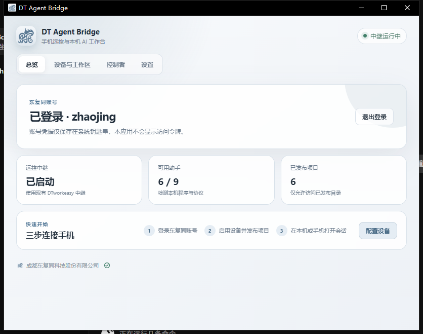
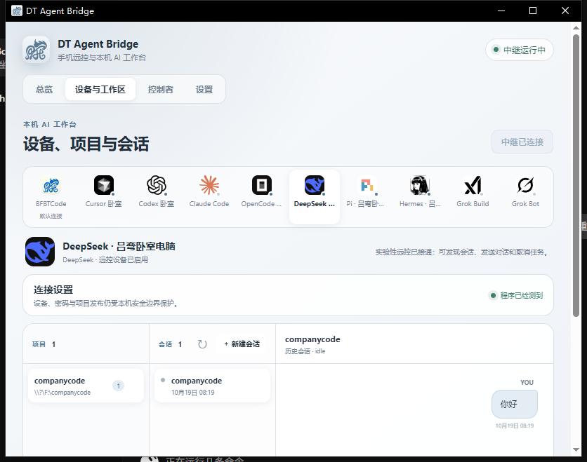
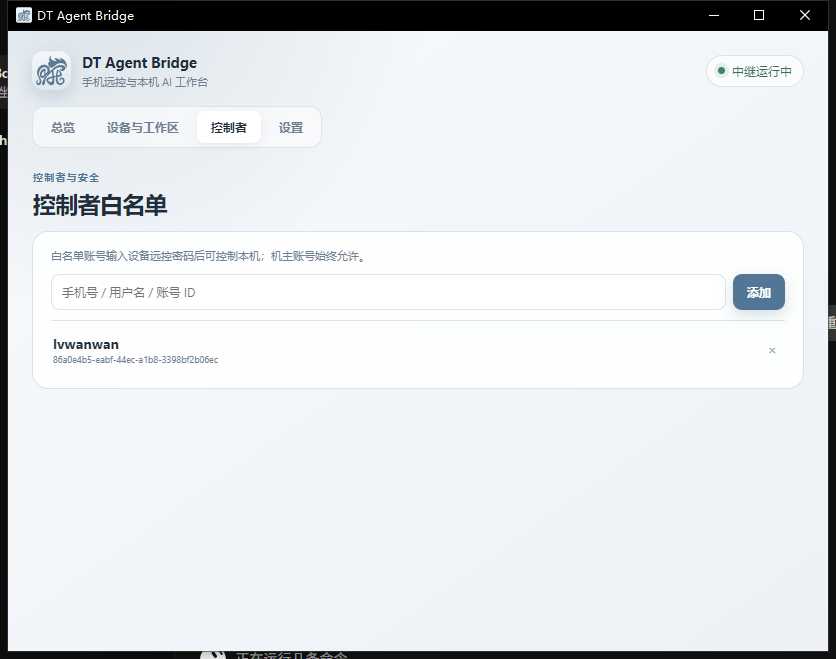
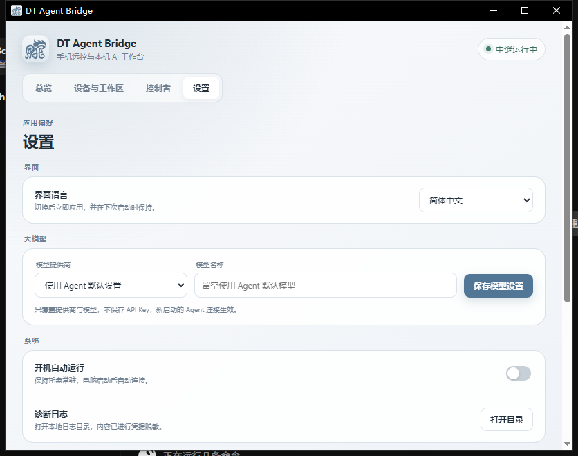

# BFBTbridge

<p align="center">
  
</p>

**电脑常驻桥接 · 手机扫码远控本机 Cursor / Codex / BFBT Code**

> Distribution-only repository. Installers and docs only — **no source code**.

官网：[www.dtrony.com](https://www.dtrony.com) · 文档：[技术文档中心](https://www.dtrony.com/docs) · 姊妹产品：[BFBT Code](https://github.com/dongfutong/BFBTCode) · [DTworkeasy Mobile](https://github.com/dongfutong/DTworkeasy-Mobile)

---

## 中文

### 一句话简介

**BFBTbridge** 是安装在电脑上的常驻桥接程序：保持运行后，用手机端 [DTworkeasy](https://github.com/dongfutong/DTworkeasy-Mobile) 扫码配对，即可远程使用本机上的 **Cursor**、**Codex** 以及 **BFBT Code** 等 Agent。

### 主要特性

- 🖥️ **托盘常驻**：Windows / macOS 桌面版托盘运行；Linux 提供无桌面依赖的 CLI/TUI（`dt-bridge`）
- 📱 **扫码配对**：与 DTworkeasy 手机端同一官网账号，扫码完成设备配对
- 🤖 **多 Agent**：暴露 Cursor CLI ACP、Codex CLI app-server 等本机能力
- 🔄 **应用内更新**：可检查官网新版本，落盘前校验 SHA-256
- 🔐 **签名分发**：Windows MSI 已签名；macOS DMG 已公证（notarized）；Linux 包提供 SHA256 / GPG

### 系统要求

| 平台 | 要求 |
|------|------|
| Windows | x64，推荐 Windows 10/11 |
| macOS | Apple Silicon（aarch64），macOS 13.0+ |
| Linux | x86_64，glibc ≥ 2.35（建议 Ubuntu 22.04+），无需 GTK/WebKit |

### 安装步骤

#### Windows

1. 从本仓库 [Releases](../../releases) 下载 `BFBTbridge_*_x64_zh-CN.msi`（与官网一致；历史 en-US MSI / setup.exe 见标签 `v1.0.8.26101801`，文件名同为 `BFBTbridge_*`）
2. 双击安装。若出现「Windows 已保护你的电脑」，确认来自本仓库/官网后点「更多信息」→「仍要运行」
3. 从开始菜单打开 **BFBTbridge**，登录东复同账号并保持运行
4. 在手机 DTworkeasy 中扫码配对

#### macOS（Apple Silicon）

1. 下载 `BFBTbridge_*_aarch64.dmg`
2. 打开 DMG，将应用拖入「应用程序」
3. 首次打开若提示身份不明，到「系统设置 → 隐私与安全性」点「仍要打开」
4. 登录账号，配合手机 DTworkeasy 扫码使用

#### Linux（TUI / 无桌面服务器）

```bash
# deb
sudo dpkg -i bfbtbridge-tui_1.0.0_amd64.deb

# 或 tar.gz + 校验
sha256sum --check SHA256SUMS --ignore-missing
python3 install.py bfbtbridge-tui_1.0.0_linux_x86_64.tar.gz \
  --checksums SHA256SUMS
```

前台服务示例：

```bash
dt-bridge serve --credential-store protected-file
dt-bridge login
dt-bridge doctor --json
dt-bridge devices qr --agent opencode
dt-bridge tui
```

### 下载表（Release 资源）

下列文件名与 Latest Release [`v1.0.8.26102002`](../../releases/tag/v1.0.8.26102002) 的资源一致（`BFBTbridge_*` / `bfbtbridge-tui_*`）。

| 平台 | 文件名 | 说明 |
|------|--------|------|
| Windows (zh-CN) | [`BFBTbridge_1.0.8.26102002_x64_zh-CN.msi`](../../releases/download/v1.0.8.26102002/BFBTbridge_1.0.8.26102002_x64_zh-CN.msi) | MSI 安装包（与官网一致） |
| macOS | [`BFBTbridge_1.0.8.26102001_aarch64.dmg`](../../releases/download/v1.0.8.26102002/BFBTbridge_1.0.8.26102001_aarch64.dmg) | Apple Silicon（已公证） |
| Linux deb | [`bfbtbridge-tui_1.0.0_amd64.deb`](../../releases/download/v1.0.8.26102002/bfbtbridge-tui_1.0.0_amd64.deb) | Ubuntu/Debian |
| Linux tar.gz | [`bfbtbridge-tui_1.0.0_linux_x86_64.tar.gz`](../../releases/download/v1.0.8.26102002/bfbtbridge-tui_1.0.0_linux_x86_64.tar.gz) | 便携包 |
| 校验 | [`SHA256SUMS`](../../releases/download/v1.0.8.26102002/SHA256SUMS) / [`install.py`](../../releases/download/v1.0.8.26102002/install.py) | 校验与安装脚本 |

> 说明：官网当前 Windows 渠道以 zh-CN MSI 为主；历史 en-US MSI / NSIS setup 仍可在旧 Release 中找到。

也可从官网下载中心获取：<https://www.dtrony.com/>

### 截图

实拍自当前已发布安装包的运行界面（非 BFBT Code）。文档中的产品名称是 **BFBTbridge**；截图像素保持实拍，未改字。

| 总览 Overview | 设备与工作区 Devices / agents |
|:---:|:---:|
|  |  |
| **控制者 Controllers** | **设置 Settings** |
|  |  |

### 与姊妹产品的关系

```
手机 DTworkeasy  ──扫码──►  BFBTbridge（电脑常驻）
                              │
                              ├── Cursor / Codex
                              └── BFBT Code（旗舰 AI 编程助手）
```

- **BFBT Code** 需要试用或会员；**DTworkeasy** 注册即可免费使用  
- 远控电脑端 BFBT Code 时，电脑端须处于试用/会员可用状态  

### 许可与声明

本仓库为 **发行版分发仓库**，仅包含安装包、校验文件与说明文档，**不包含源代码**。  
软件版权归 **成都东复同科技股份有限公司** 所有。更多条款见 [官网隐私政策](https://www.dtrony.com/api/legal/privacy)。

---

## English

### One-liner

**BFBTbridge** is the tray-resident desktop bridge for the [DTworkeasy](https://github.com/dongfutong/DTworkeasy-Mobile) mobile app. Keep it running on your PC, pair via QR code, and remotely drive local **Cursor**, **Codex**, and **BFBT Code** agents.

### Features

- Tray-resident on Windows / macOS; headless CLI/TUI (`dt-bridge`) on Linux (no GTK/WebKit)
- Same Dongfutong account as the website and DTworkeasy
- Multi-agent adapters (Cursor ACP, Codex app-server, and more)
- In-app updates with SHA-256 verification
- Signed Windows MSI; notarized macOS DMG; Linux packages with checksums / GPG

### Requirements

| Platform | Notes |
|----------|--------|
| Windows | x64, Windows 10/11 recommended |
| macOS | Apple Silicon only, macOS 13.0+ |
| Linux | x86_64, glibc ≥ 2.35 (Ubuntu 22.04+) |

### Install

**Windows:** download [`BFBTbridge_1.0.8.26102002_x64_zh-CN.msi`](../../releases/download/v1.0.8.26102002/BFBTbridge_1.0.8.26102002_x64_zh-CN.msi) from [Releases](../../releases), install, sign in, and open **BFBTbridge** from the Start Menu. Keep it running, then pair from DTworkeasy.

**macOS:** open [`BFBTbridge_1.0.8.26102001_aarch64.dmg`](../../releases/download/v1.0.8.26102002/BFBTbridge_1.0.8.26102001_aarch64.dmg), drag to Applications, allow in Privacy & Security if prompted, sign in, then pair.

**Linux:**

```bash
sudo dpkg -i bfbtbridge-tui_1.0.0_amd64.deb
# or verify SHA256SUMS, then:
# python3 install.py bfbtbridge-tui_1.0.0_linux_x86_64.tar.gz --checksums SHA256SUMS
dt-bridge serve --credential-store protected-file
```

Latest (`v1.0.8.26102002`) assets use `BFBTbridge_*` and `bfbtbridge-tui_*` names. Tag `v1.0.8.26101801` uses the same prefixes.

### Downloads

See the Chinese table above for exact asset filenames under [Releases](../../releases), or use <https://www.dtrony.com/>.

### Screenshots

Live captures of the currently published installer (not BFBT Code). These docs call the product **BFBTbridge**; screenshot pixels are left as captured. See the Chinese section above.

### License note

This repository is **distribution-only** (installers + docs, **no source**).  
© Chengdu Dongfutong Technology Co., Ltd. See [Privacy Policy](https://www.dtrony.com/api/legal/privacy).

---

## 日本語（抜粋）

**BFBTbridge** は PC 常駐のブリッジです。スマホの DTworkeasy で QR ペアリングすると、本機の Cursor / Codex / BFBT Code を遠隔利用できます。Windows・macOS（Apple Silicon）・Linux（TUI）に対応。配布専用リポジトリ（ソース無し）。公式サイト：https://www.dtrony.com

## 한국어（요약）

**BFBTbridge**는 PC에 상주하는 브리지입니다. DTworkeasy 모바일 앱에서 QR로 페어링하면 로컬 Cursor / Codex / BFBT Code 를 원격 제어할 수 있습니다. Windows·macOS(Apple Silicon)·Linux(TUI) 지원. 배포 전용 저장소(소스 없음). 공식: https://www.dtrony.com

---

**Suggested Release tag:** `v1.0.8.26102002`（Windows zh-CN） / 可同时附带 macOS `1.0.8.26102001` 与 Linux `1.0.0` 资源  
**Docs:** https://www.dtrony.com/docs
